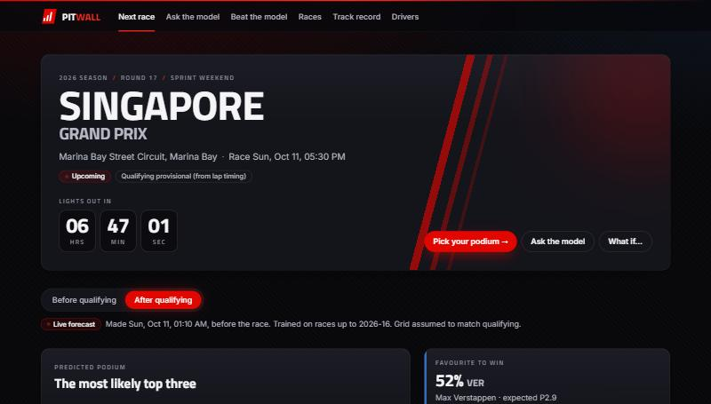
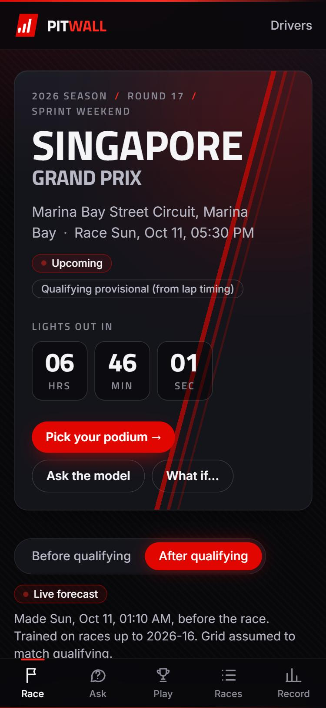
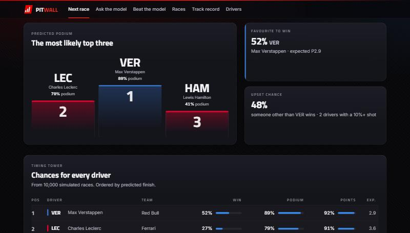
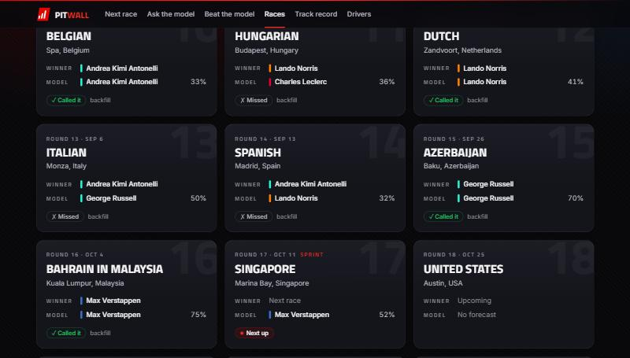
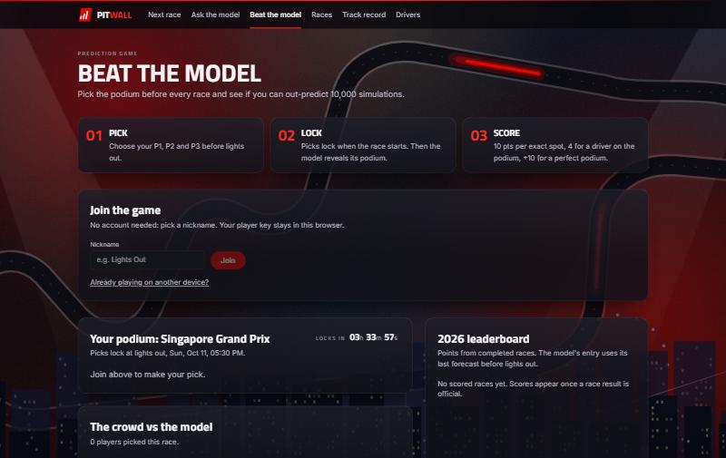
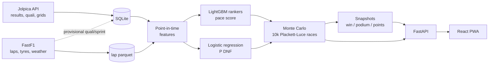

# PitWall

Probabilistic Formula 1 race predictions, as an installable web app.

For every Grand Prix the model estimates each driver's chance to **win, reach the podium and
score points**, plus their full finishing-position distribution. It forecasts twice per weekend,
after practice and again after qualifying, and every forecast is scored after the race against
simple rules of thumb. It beats them.

<p align="center">
  
  
</p>

## What you can do

- **See the next race**: favourite, most likely podium, win / podium / points chances, a
  driver × position heatmap, and how qualifying moved each driver. A live countdown runs to
  lights out.
- **Ask the model**: *Will Hamilton finish ahead of Leclerc? Both Ferraris on the podium? Exactly
  VER–LEC–HAM?* Questions are answered from 10,000 simulated races, so every answer is consistent
  with every other. For races already run, each answer also says whether it came true.
- **What if…**: rearrange the grid, send a driver to the pit lane, rule someone out, force a
  retirement, or turn up the chaos, and the model re-runs the race. Before qualifying, a
  hypothetical grid doubles as a qualifying result ("what if Leclerc takes pole?").
- **Beat the model**: pick the podium before each race and climb the season leaderboard
  against other players and the model itself. No account needed; picks lock at lights out.
- **Standings**: the drivers' and constructors' championships with countback tie-breaks,
  each driver's last five results, who can still mathematically win the title, and a chart of
  how the points race unfolded.
- **Races**: every round with its circuit map, the winner, the model's favourite and whether
  it called it.
- **Track record**: in plain English first (*was the model closer than "everyone finishes where
  they start"? in how many races? does 30% happen 30% of the time?*), with the full
  walk-forward backtest, calibration chart and every scored forecast one click away.
- **Install it**: it's a PWA. Add it to your home screen, and it still shows the last data you
  saw when offline.

<p align="center">
  
  
  
</p>

## Results

Walk-forward backtest over 190 races (2018–2026): every race is predicted by a model retrained
on **only the races before it** (`f1p backtest`), so the 2018 races learn from 2014–2017 alone.
Spearman = correlation of predicted vs actual finishing order; log-loss and Brier score judge the
probabilities (lower is better).

**After qualifying**

| | Spearman | Winner right | Top-3 overlap | Win log-loss | Podium Brier | Points Brier |
|---|---|---|---|---|---|---|
| **Model** | **0.665** | **56%** | 67% | **1.31** | **0.068** | **0.154** |
| Grid order | 0.626 | 54% | **69%** | 1.50 | 0.069 | 0.168 |

**Before qualifying**

| | Spearman | Winner right | Top-3 overlap | Win log-loss | Podium Brier | Points Brier |
|---|---|---|---|---|---|---|
| **Model** | **0.609** | 44% | 58% | **1.57** | **0.080** | **0.167** |
| Team form | 0.593 | 44% | 56% | 1.84 | 0.086 | 0.177 |
| Championship order | 0.588 | **45%** | **59%** | 1.74 | 0.082 | 0.178 |
| Fastest in practice | 0.559 | 24% | 52% | 2.03 | 0.093 | 0.184 |
| Uniform (knows nothing) | ≈0 | – | 13% | 3.00 | 0.127 | 0.250 |

In plain terms: after qualifying, the model's order is closer to the result than "everyone
finishes where they start" in 118 of 190 races (70 the other way, 2 ties), and in 8 of the 9
seasons (2020, the COVID season, is the exception). Before qualifying it beats championship order
in all 9. The probabilities are calibrated: things it gives ~30% happen 29–30% of the time.
Honest caveats: grid order and championship order name the podium slightly more often, and
championship order picks the winner a little more often before qualifying.

## How it works



1. **Data**: race results, qualifying and grids from the [Jolpica API](https://github.com/jolpica/jolpica-f1)
   (2014+); lap times, tyres, track status and weather from [FastF1](https://github.com/theOehrly/Fast-F1) (2018+).
2. **Features (41)**: strictly point-in-time. A leakage test rebuilds every feature from a
   database truncated at the prediction moment and requires identical values. Practice pace is
   measured as % gap to the field (long runs and best laps), alongside recency-weighted team and
   driver form, teammate deltas, reliability, championship standing, circuit overtaking
   difficulty and regulation era. After qualifying it adds grid, qualifying gap and pit-lane
   starts.
3. **Pace model**: two LightGBM LambdaRank models, one with linear gains (the whole order) and
   one with exponential gains (the front of the field), averaged. Recency weighting uses a
   half-life of 30 races, ×3 for the current regulation era, which matters after the 2026 reset.
4. **Retirements**: a small logistic regression. A gradient-boosted model did *worse* than the
   plain DNF rate, because retirements are mostly luck.
5. **Simulation**: each race is simulated 10,000 times. Retirements are drawn first, then the
   finishers' order via Plackett–Luce (Gumbel-max trick). The randomness ("temperature") is
   fitted on held-out races' top three. Fitting the whole order made win odds too flat.
   Gumbel noise alone has a thin lower tail, so a front-runner who didn't retire almost never
   finished, say, ninth, and the heatmap showed hard 0%s. Each driver therefore also has a
   chance of a **bad day** (first-lap damage, a penalty, a slow stop) that costs an
   exponentially distributed amount of pace; its rate and size are fitted on held-out races by
   the likelihood of every driver's actual finishing place (currently about 14–20% per driver
   per race). In the 2022–2026 backtest that improved the log-loss on exact finishing places from
   2.57 to 2.52.
6. **Live operation**: forecasts are immutable snapshots, flagged `live` (made before qualifying
   / the race) or `backfill`. Jolpica can lag a day, so qualifying and sprint classifications are
   rebuilt provisionally from lap timing and replaced by the official results when published.

## Running it

### Development

```bash
git clone https://github.com/sohamnetic/PitWall.git
cd PitWall

# backend (Python 3.10+)
cd backend
python -m venv .venv
.venv/Scripts/activate              # Windows; `source .venv/bin/activate` elsewhere
pip install -e ".[dev]"
pytest
uvicorn f1p.api.main:app --reload   # API on :8000, docs at /docs

# frontend (Node 22+), second terminal
cd frontend
npm install
npm run dev                         # http://localhost:5173, proxies /api to :8000
```

### Data and models

```bash
f1p ingest --seasons 2014-2026 --no-laps   # results, qualifying, calendar (~2 min)
f1p ingest --seasons 2025-2026 --no-results # lap data for recent seasons
f1p train                                   # pace + DNF models, both stages
f1p backtest --seasons 2018-2026            # walk-forward evaluation (optional)
```

FastF1 allows ~500 requests/hour (≈60 sessions/hour), so lap data for **2018–2024 takes about
15 hours**. Run it overnight: `f1p ingest --seasons 2018-2024 --no-results`. It's incremental
and can be stopped and resumed. Without it, practice-pace features are simply missing for
those years.

### Race weekends

```bash
f1p auto      # refresh data, forecast after practice / qualifying, score finished races
```

`auto` only acts when something new is available, so it's safe to run hourly. On Windows:

```bash
schtasks /Create /SC HOURLY /TN "PitWall autopilot" /TR "D:\f1-predictor\backend\.venv\Scripts\f1p.exe auto"
```

Other commands: `f1p predict --race next`, `f1p score --race last`, `f1p record` (track
record), `f1p status` (what's in the database), `f1p features --stage pre|post`, and
`f1p backfill --season 2026` (predict every finished race of a season from data available
before it, labelled *backfill*, then score them, so the archive has history from day one).

### Production

One process serves the API under `/api` and the built app for everything else:

```bash
npm --prefix frontend run build
uvicorn f1p.api.server:app --app-dir backend --host 0.0.0.0 --port 8000
```

Or with Docker. The `autopilot` service runs `f1p auto` hourly:

```bash
docker compose up -d                        # http://localhost:8000
docker compose run --rm app f1p ingest --seasons 2014-2026 --no-laps
docker compose run --rm app f1p ingest --seasons 2025-2026 --no-results
docker compose run --rm app f1p train
```

Data lives in `./data` (mounted at `/data`). CI builds the image and smoke-tests it.

### Free hosting: Vercel + Render

No card needed. The site runs on **Vercel** and the API on **Render's free plan**.

- **Render** (API): New → Blueprint → this repository. `render.yaml` creates the `pitwall-api`
  service from `Dockerfile.render`. The free plan has no persistent disk, so the image bakes in
  a data snapshot from the `deploy-data` branch and retrains the models during the build.
  Free services sleep after 15 minutes idle (about a minute to wake, and the app says so), and
  runtime writes such as game picks are lost on restart.
- **Vercel** (site): import this repository with **Root Directory `frontend`**. `vercel.json`
  builds with `--mode vercel`, which points the app at the API address in
  `frontend/.env.vercel`. The API allows `https://pitwall*.vercel.app` origins
  (`F1P_CORS_ORIGIN_REGEX`).
- **Updating the data** after a race weekend: run `f1p auto` locally, then
  `bash scripts/publish_data.sh` and redeploy the Render service.

## API

Interactive docs at `/docs` (dev) or `/api/docs` (production).

| Endpoint | Returns |
|---|---|
| `GET /seasons`, `/seasons/{year}/races` | Calendar: status, winner, the model's favourite, latest snapshot ids |
| `GET /seasons/{year}/standings` | Drivers' and constructors' championships, title contention, points after every round |
| `GET /races/next`, `/races/{id}` | A race with results, sprint, qualifying and its snapshots |
| `GET /races/{id}/predictions?stage=` | Latest snapshot: per-driver probabilities, full position distribution, actual finish and score |
| `GET /races/{id}/field` | Drivers in starting (or predicted) order: the what-if editor's start |
| `POST /races/{id}/simulate` | Answers custom questions, optionally under a what-if scenario |
| `GET /performance` | Backtest summary, per-season results, calibration, a plain-English head-to-head vs the obvious guess, and every forecast's pick, winner and score |
| `GET /drivers`, `/drivers/{id}` | Line-up; a driver's form and prediction history |
| `POST /players`, `GET /players/me`, `GET /players/me/picks` | Join the game (returns a private player key); your picks |
| `GET/PUT /races/{id}/picks/me` | Your podium pick (editable until lights out) |
| `GET /races/{id}/picks/summary`, `GET /leaderboard` | Crowd vs model, and the season standings |

Player keys are random tokens; only their SHA-256 hash is stored. The model's pick is hidden
until picks lock so nobody can simply copy it.

## Project layout

```
backend/f1p/
  data/        Jolpica + FastF1 ingest, provisional classifications, SQLAlchemy schema
  features/    point-in-time feature builder (form, pace, circuit) + truncation for leakage tests
  models/      baselines, rankers, DNF model, simulator, calibration, questions, what-if scenarios
  eval/        metrics + walk-forward backtest
  pipeline/    CLI (f1p) and live predict / score
  api/         FastAPI app, queries, simulation service, production server
  game.py      'Beat the model' scoring
backend/tests/ 96 tests incl. leakage, API, game and server tests
frontend/src/  React + TypeScript (Vite, TanStack Query, Recharts, Tailwind), PWA
notebooks/     exploratory analysis
scripts/       icon generator, circuit-map builder
```

## Status

- [x] 1. Project skeleton, CI
- [x] 2. Data ingest (results 2014+, lap data 2018+)
- [x] 3. Point-in-time features with leakage tests
- [x] 4. Baselines + walk-forward backtest
- [x] 5. Ranker, DNF model, simulator, calibration
- [x] 6. Live predict / score / autopilot
- [x] 7. API
- [x] 8. Frontend
- [x] 9. App features (ask, what-if, game, PWA), production server, Docker

Ideas for later: natural-language questions on top of the question engine, push notifications
when a forecast changes, a hosted deployment with the autopilot running every weekend.

---

PitWall is an independent fan project, not affiliated with Formula 1, the FIA or any team.
Data © their providers (Jolpica, FastF1 / F1 live timing). Circuit outlines from
[bacinger/f1-circuits](https://github.com/bacinger/f1-circuits) (MIT), converted by
`scripts/make_circuits.py`.
